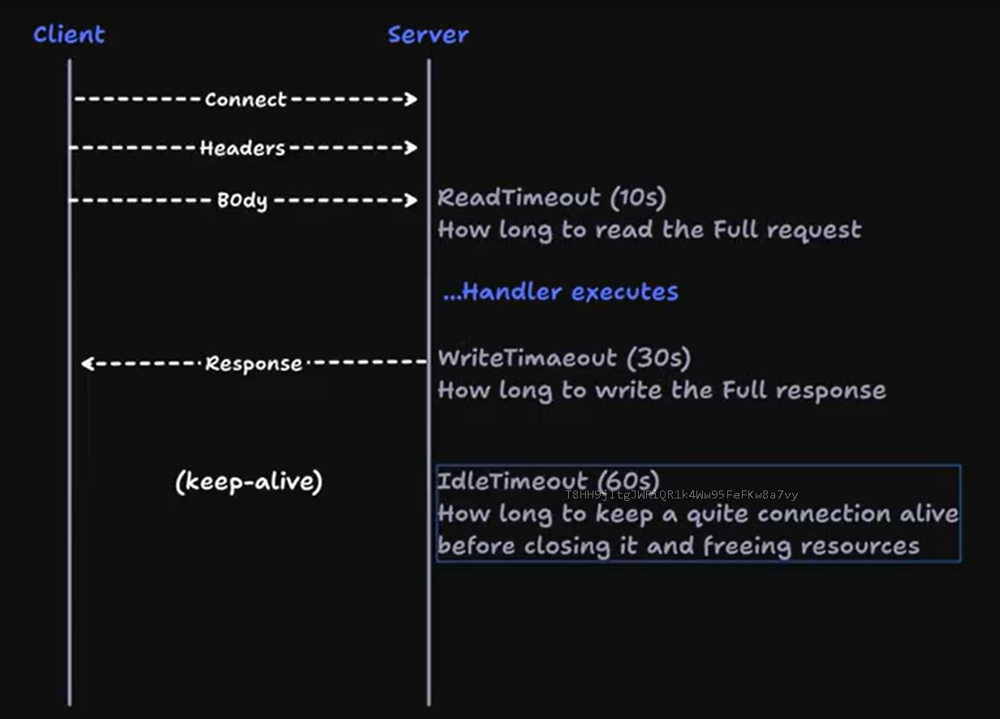

By default go has its default so we have to set explicitly via the http.Server struct

https://github.com/chickensoft-games/godotenv

To load all environment variables from a .env file into the application we can use the godotenv package

https://pkg.go.dev/github.com/joho/godotenv

internal folder in go is actually a special folder that is used to restrict access to certain packages. Any package placed inside the internal folder can only be imported by other packages that are within the same module or submodule

So if someone tries to import our code as then they wont get access to the interal packages its only within this project

In go there is no concept of private or public packages like in other languages. All packages are public by default, but the internal folder allows us to create a package that is only accessible within the same module or submodule.

In Go there is no centralized repository for packages like npm or pip. 
Instead go packages are just the source code that is hosted on a version control system like GitHub, GitLab, or Bitbucket. 
When you import a package in Go, you specify the URL of the repository where the package is hosted.

Ex: import "github.com/user/package" (that package name is actually the name of the repository on GitHub)

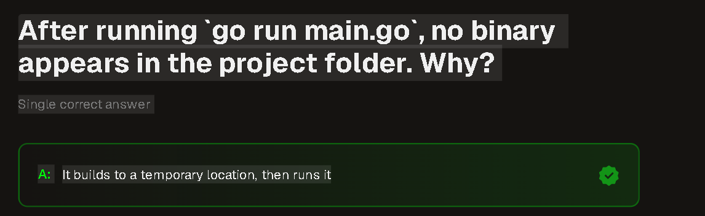

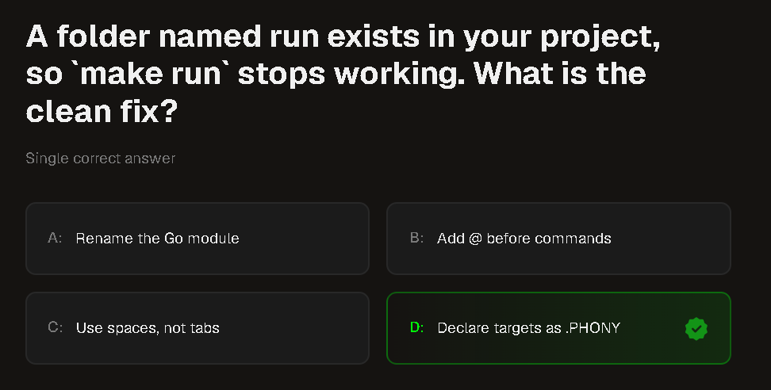

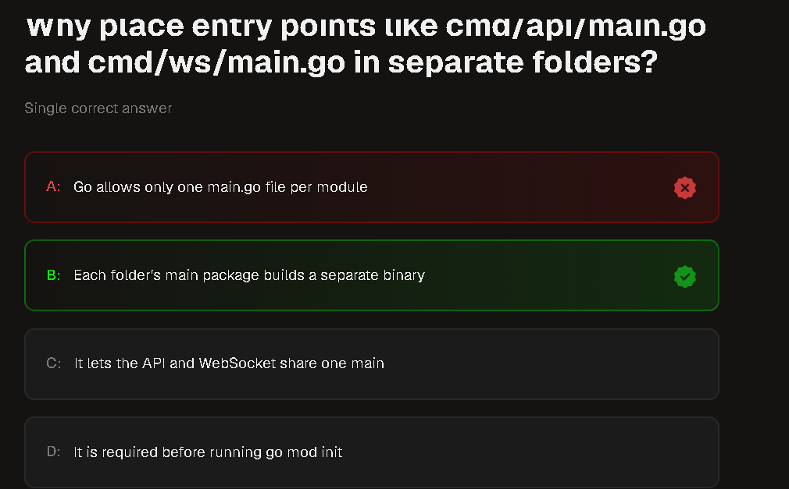

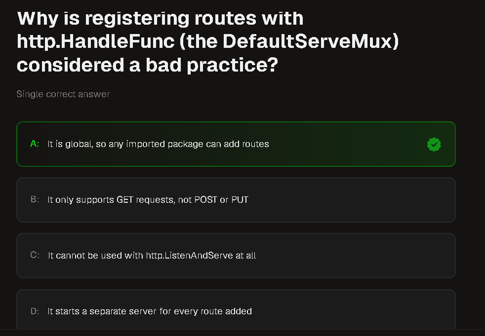

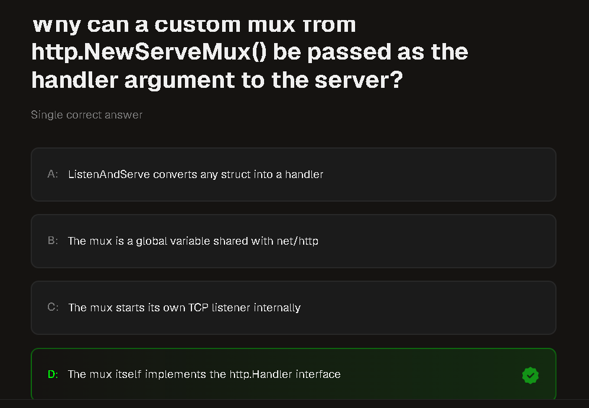

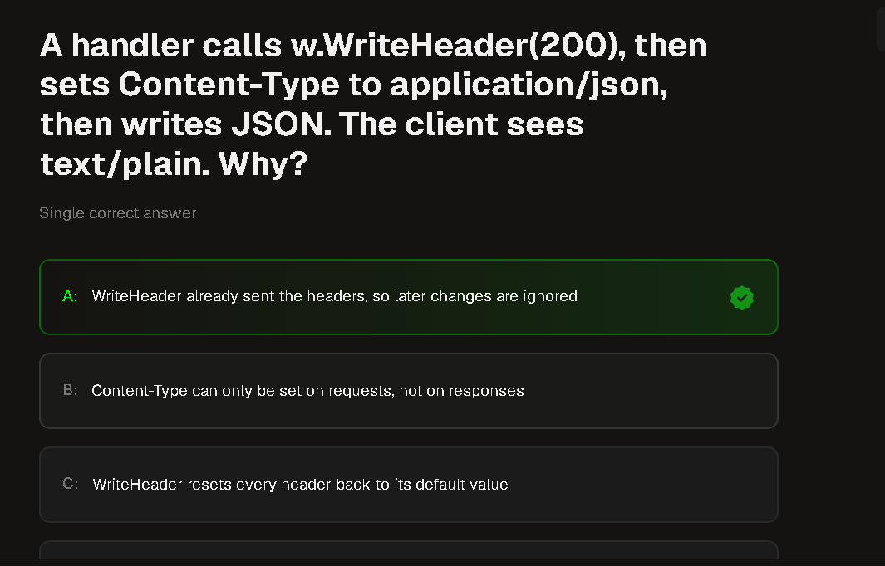

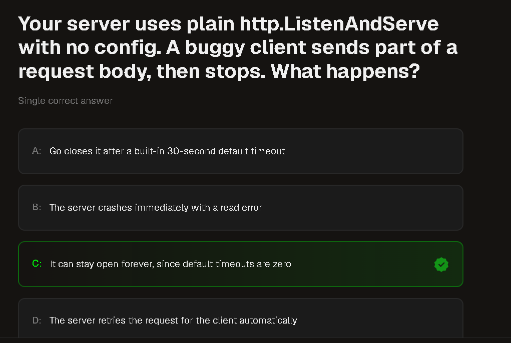

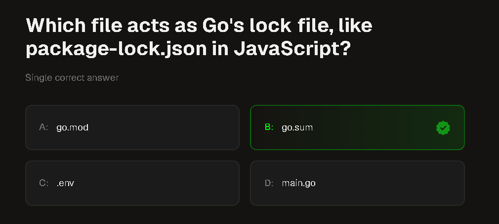

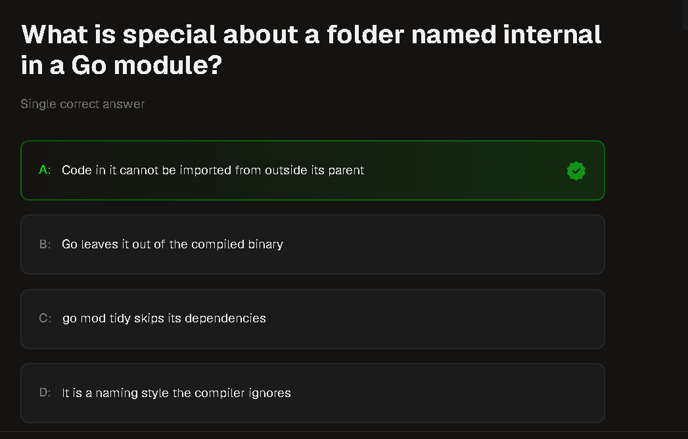

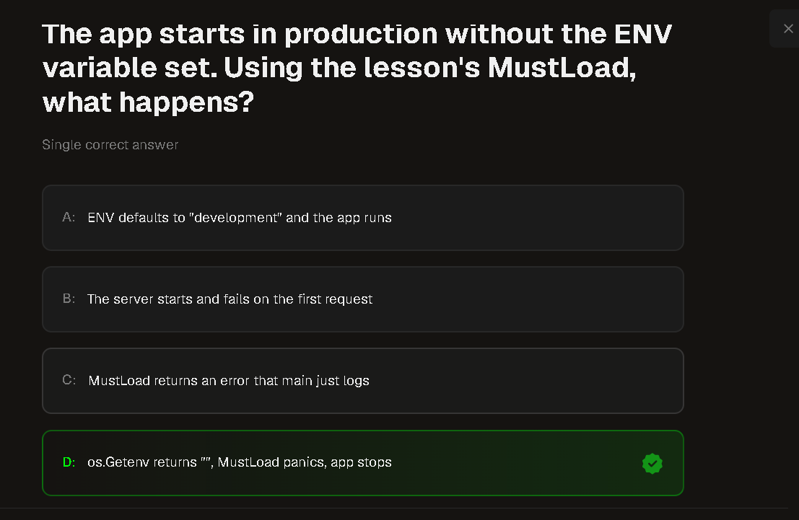

Must in go funcs is a convention that must always execute the function and always throw a panic when function doesnt execute sucessfully , it is used to load env variables from .env file and if it fails to load it will panic and stop the execution of the program

Here weused MustLoad function (following this convention)